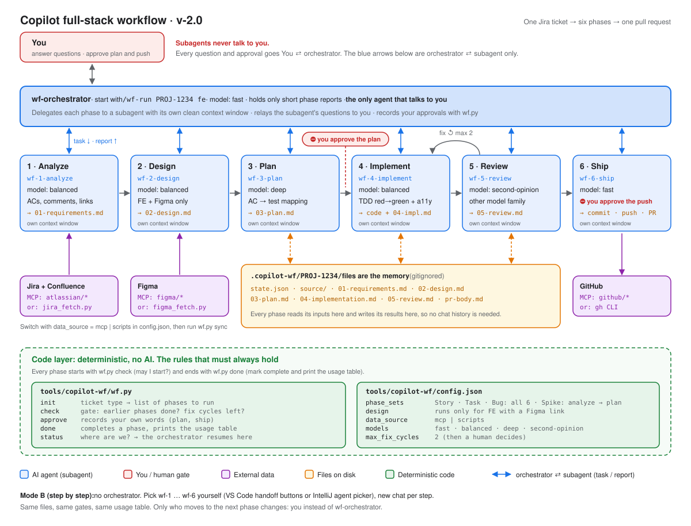

# Copilot full-stack workflow

A 6-step, human-gated workflow for GitHub Copilot (VS Code for React/TS, IntelliJ for Spring Boot):

```
1 Analyze ──► 2 Design ──► 3 Plan ──⛔ you approve ──► 4 Implement (TDD) ──► 5 Review ──⛔ you approve ──► 6 Ship
 Jira +        Figma →      AC→test     plan            red→green→refactor     different      commit/push/PR
 Confluence    components   mapping                     + accessibility        model          create or update
                (FE only)
```

After every step you see a usage table (an estimate, plus the real credits if you log them).
To learn *why* it's built this way, read **[LEARNING.md](LEARNING.md)**.

📊 **Visual overview:** [docs/workflow-diagram.svg](docs/workflow-diagram.svg). It shows the whole workflow on one page: the orchestrator,
the six phase subagents, the human gates, the data sources (MCP or scripts), the shared files, and the code layer that enforces the rules.

[](docs/workflow-diagram.svg)

## What's inside

```
.github/
├── copilot-instructions.md     always-on rules (kept short: costs tokens on every request)
├── instructions/               installed by `wf.py use-stack` (e.g. angular.instructions.md)
├── agents/                     WHO does each step: model, tools, handoff buttons
│   ├── wf-orchestrator.agent.md      v2: runs every phase as a subagent (clean context)
│   └── wf-1-analyze … wf-6-ship.agent.md
├── skills/                     HOW each step is done: method, iron laws, templates
│   ├── workflow-orchestration/       v2: the conductor's loop + phase-report contract
│   ├── ticket-analysis/  figma-to-components/  implementation-plan/
│   └── tdd-implementation/  code-review/  ship-pr/
└── prompts/                    slash commands: /wf-run (orchestrated), /wf-start (step by step), /wf-status
tools/copilot-wf/               deterministic code (no AI)
├── config.json                 phase sets, stacks (detection), mcp/scripts switch, model tiers
├── wf.py                       state, gates, usage table, sync, detect / use-stack
├── stacks/                     one folder per language: react/ angular/ spring-boot/ (how to add one: stacks/README.md)
├── jira_fetch.py               scripts mode: Jira + Confluence → trimmed markdown
├── figma_fetch.py              scripts mode: one Figma frame → compact outline (+PNG)
└── tests/                      python3 -m unittest discover tools/copilot-wf/tests
```

## Install into a repo (FE repo and BE repo separately)

1. Copy `.github/` and `tools/` into the repo root. If the repo already has `.github/copilot-instructions.md`, **merge**
   the two files instead of overwriting yours.
2. Add the artifacts folder to `.gitignore` (it holds ticket content and must never be committed):
   ```
   .copilot-wf/
   ```
3. Pick the repo's stack and install its Copilot instructions:
   ```bash
   python3 tools/copilot-wf/wf.py detect              # e.g. "angular  side=fe"
   python3 tools/copilot-wf/wf.py use-stack angular    # → .github/instructions/angular.instructions.md
   ```
   Supported: `react`, `angular`, `spring-boot`. Full-stack repo: `use-stack angular spring-boot`.
   Put your team's real conventions in `tools/copilot-wf/stacks/<stack>/`, not in the installed copy.
   New language? Follow [tools/copilot-wf/stacks/README.md](tools/copilot-wf/stacks/README.md).
4. Make the MCP server names match: the agents use `atlassian/*`, `figma/*`, `github/*`. If your MCP config names
   the servers differently, edit `mcp_tools` in `tools/copilot-wf/config.json`, then run `python3 tools/copilot-wf/wf.py sync`.
5. Check the model names in `config.json → models.tiers` against your Copilot model picker, then run `wf.py sync`.

## Use it: two modes

### A. Orchestrated (v2, recommended): one chat, a clean context per phase
`/wf-run PROJ-1234` (or pick the **wf-orchestrator** agent and type `PROJ-1234`). The stack is detected; in a monorepo add it: `PROJ-1234 angular`.

The orchestrator runs each phase as a **subagent** in its own context window and only receives a short
*phase report* back. You talk only to the orchestrator: it relays questions, asks you to approve the plan and the push,
and shows a usage line after each phase. Interrupted? Run `/wf-run PROJ-1234` again and it resumes from `wf.py status`.

```
you ⇄ wf-orchestrator  (holds only ~20-line reports)
          ├─► wf-1-analyze   [own context] → 01-requirements.md
          ├─► wf-2-design    [own context] → 02-design.md
          ├─► wf-3-plan      [own context] → 03-plan.md ──⛔ you approve (wf.py approve)
          ├─► wf-4-implement [own context] → code + tests ◄─┐ fix cycle (capped by wf.py)
          ├─► wf-5-review    [own context] → 05-review.md ──┘
          └─► wf-6-ship      [own context] → drafts ──⛔ you approve ──► commit / push / PR
```

### B. Step by step (v1 style): you drive each phase
**VS Code:** `/wf-start PROJ-1234`, then the handoff button at the end of each step.
**IntelliJ:** pick `wf-1-analyze`, type `PROJ-1234`, then pick the agent each step names next.
Tip: start a **new chat** for each step. The files in `.copilot-wf/` carry everything over, so you get a clean context per step.

### IntelliJ and the orchestrator
In VS Code, the `agents:` list in `wf-orchestrator.agent.md` is enforced. JetBrains/Copilot harnesses ignore that field and
delegate by name, which the orchestrator's instructions already do ("run the `wf-3-plan` agent as a subagent…"). If your plugin
version doesn't support subagents yet, use mode B.

Anytime: `/wf-status PROJ-1234`, or run `python3 tools/copilot-wf/wf.py status --ticket PROJ-1234`.
(On Windows use `python` or `py` instead of `python3`.)

## MCP mode vs scripts mode

```jsonc
// tools/copilot-wf/config.json
"data_source": "mcp"      // or "scripts"
```
Then run `python3 tools/copilot-wf/wf.py sync`. That also adds or removes the MCP tools on the agents.
LEARNING.md §3 explains the trade-off and how to measure it.

### Scripts mode setup

Set these as **environment variables** (shell profile, or your OS keychain/secret manager). Never in a file in the repo:

| Variable | For | Notes |
|---|---|---|
| `JIRA_BASE_URL` | Jira | your Jira site, `https://…` |
| `JIRA_PAT` | Jira Data Center/Server | **or** the pair below |
| `JIRA_EMAIL` + `JIRA_API_TOKEN` | Jira Cloud | |
| `JIRA_AC_FIELD` | optional | custom field id holding ACs, e.g. `customfield_12345` |
| `CONFLUENCE_BASE_URL` | optional | defaults to `<JIRA_BASE_URL>/wiki` on `*.atlassian.net` |
| `CONFLUENCE_PAT` | optional | Confluence Data Center token |
| `FIGMA_TOKEN` | Figma | personal access token, read-only scope |
| — | GitHub | `gh auth login` once (the `gh` CLI) |

Try it by hand:
```bash
python3 tools/copilot-wf/jira_fetch.py PROJ-1234 --follow-confluence
python3 tools/copilot-wf/figma_fetch.py "https://www.figma.com/design/<key>/<name>?node-id=1-2" --ticket PROJ-1234 --image
```

## Safety built in
- Credentials only from env vars; never printed; only sent to the host they belong to; HTTPS only.
- Confluence links on other hosts are ignored. Attachments are downloaded only from your Jira host, images/text only, max 5 MB.
- `wf.py check` blocks a phase until the earlier ones are done (e.g. no coding before the plan is approved).
- Plan and ship approvals are recorded with your own words (`wf.py approve`). `done` refuses without one, and Step 6 runs
  `check --approved` right before the first git command.
- Review → fix loops are capped (`max_fix_cycles` in config). Then a human decides.
- Step 6 shows one exact summary and does nothing until you say yes. No force-push, no `--no-verify`, no pushes to protected branches, no merging.
